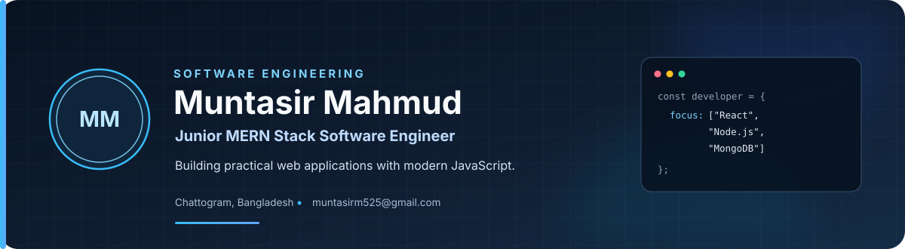

<!-- Profile README: https://github.com/muntasir-mahmud-abdullah -->

<!-- Banner -->

  

 

<!-- Centered introduction -->

  <h1>Hi 👋, I'm Muntasir Mahmud</h1>
  
<strong>Junior MERN Stack Software Engineer · Full-Stack JavaScript Developer</strong>

  
  

    
    
  

---

## 👨‍💻 About Me

I'm a **Junior MERN Stack Software Engineer** focused on building responsive, user-friendly web applications with modern JavaScript technologies. I work across frontend and backend development, including interface implementation, REST API integration, authentication flows, role-based features, and database-driven functionality.

I'm also completing my **BSc (Honours) in Water Resources Engineering (WRE)**. My engineering background complements my software interests, particularly where software development, data, automation, and water-resources applications intersect.

### What I'm Focused On

- Building full-stack applications with **React, Next.js, Node.js, and Express.js**.
- Improving type-safe development with **TypeScript** and strengthening my **Data Structures and Algorithms (DSA)** fundamentals.
- Practising maintainable frontend architecture, API integration, authentication, and database design.
- Completing my undergraduate studies in **Water Resources Engineering**.

### Currently Learning & Exploring

- TypeScript and practical application of advanced types.
- Data Structures and Algorithms through consistent problem-solving.
- Modern React patterns and frontend architecture.
- Opportunities to apply software, data, and automation to engineering problems.

---

## 🛠️ Technology Stack

### Languages

  

### CSS Frameworks & UI

  

### JavaScript Frameworks & Libraries

  

### Backend Development

  

### Databases & ORM

  

### Tools, Design & Deployment

  

**Additional libraries:** Redux Toolkit Query (RTK Query), React Hook Form, Zod, and DaisyUI.

---

## 🌐 Connect With Me

  
  
  
  

- 📍 **Location:** Chattogram, Bangladesh
- 📧 **Email:** [muntasirm525@gmail.com](mailto:muntasirm525@gmail.com)
- 💼 **LinkedIn:** [muntasir-mahmud-abdullah47](https://www.linkedin.com/in/muntasir-mahmud-abdullah47/)
- 🌐 **Portfolio:** [muntasir-mahmud-abdullah.netlify.app](https://muntasir-mahmud-abdullah.netlify.app/)

---

## 📊 GitHub Statistics & Analysis

  
  

  

### Contribution Activity

  <picture>
    <source media="(prefers-color-scheme: dark)" srcset="https://raw.githubusercontent.com/muntasir-mahmud-abdullah/muntasir-mahmud-abdullah/output/github-contribution-grid-snake-dark.svg" />
    <source media="(prefers-color-scheme: light)" srcset="https://raw.githubusercontent.com/muntasir-mahmud-abdullah/muntasir-mahmud-abdullah/output/github-contribution-grid-snake.svg" />
    
  </picture>

---

  

  <i>Building thoughtfully. Learning continuously. Solving real problems with software.</i>

